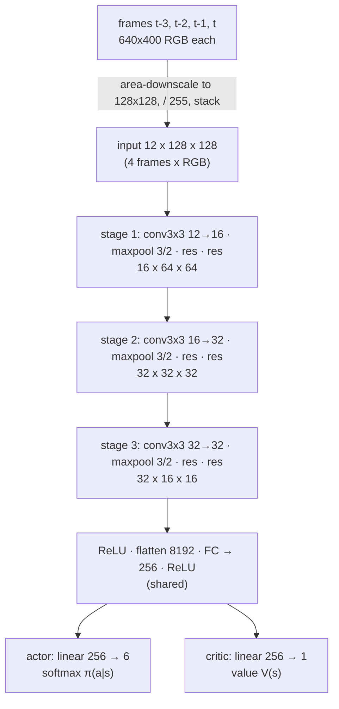
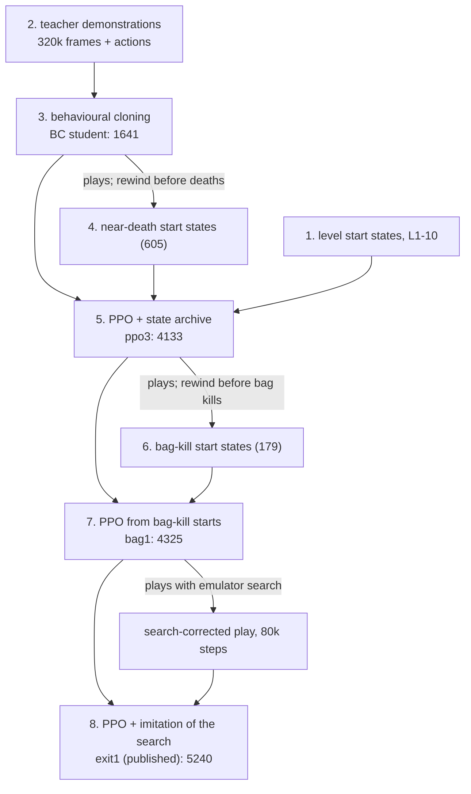

# Digger RL

An agent that plays the 1983 DOS game **DIGGER** from pixels alone. The
game runs in DOSBox Pure through a libretro pybind11 binding. The policy
is bootstrapped by imitating a hand-written teacher and then improved
with PPO; it now scores well above the teacher.

The current best policy is published in the repo:

    python watch.py checkpoints/digger_px128_pool8_grpoV2.pt --hud --sound
    python evaluate.py checkpoints/digger_px128_pool8_grpoV2.pt --episodes 20

It is `px128_pool8_bagA` (the small-head `--arch impala_pool8` rebuild
after four PPO rounds, 16M frames, the last three anchored on
search-corrected play, [HISTORY Lessons 27-29](HISTORY.md)) fine-tuned
for 100 iterations with GRPO (`train_grpo.py`): groups of 8 rollouts
from one exact emulator snapshot, half of them 6-16 steps before the
policy's own deaths, return = 0.02 x score - 10 x died (`grpo1`), then
350 more iterations with 128-step rollouts and a death penalty scaled by
how early the death comes, 10 + 15 x share of the horizon not survived
(`grpoLt2`), then 50 more iterations after refitting the critic head to
the policy's own play (held-out R^2 0.05 -> 0.80) and adding its value
estimate to the return of rollouts that survive (`grpoV2`,
[HISTORY Lesson 30](HISTORY.md)). It is the best on both measures:
7308 over 100 sampled games and 7586 over 70 greedy games, against
7251 / 7121 for `grpoLt2` and 6765 / 7388 for `grpo1`; the margins are
modest (greedy ~1.4 standard errors). `grpoLt2`, `grpo1` and bagA stay
in `checkpoints/`. The pipeline and model below
still describe the previous published policy,
`checkpoints/digger_px128_exit1.pt`; the pool8 line follows the same
steps with `--arch impala_pool8` (one more max-pool to 8x8 before the
FC layer), plus a bag-kill round with the anchor kept.

Two policies trained from a random network with PPO alone (no teacher,
score reward only, 20M frames) are also in `checkpoints/`:
`digger_px128_scratch_f4.pt` (4 frames; 4885 sampled / 5499 greedy) and
`digger_px128_scratch_f8.pt` (8 frames reaching 24 steps back; 5237 /
5341). See [HISTORY Lesson 33](HISTORY.md).

How the project got here (symbolic agents, NatureCNN, DQN/Dreamer
attempts, reward experiments, and the lessons from each) is in
[HISTORY.md](HISTORY.md).

## Model

`checkpoints/digger_px128_exit1.pt` is the pixel `Agent` from
`train_pixel.py` with the IMPALA encoder (`--arch impala`): an
actor-critic network with 2.2M parameters.



A residual block (`res`) is `x + conv3x3(ReLU(conv3x3(ReLU(x))))`,
keeping the channel count.

| Block | Layers | Output | Parameters |
|---|---|---|---:|
| input | 4 stacked frames, RGB, 128x128 | 12 x 128 x 128 | - |
| stage 1 | conv 3x3 12→16 → maxpool 3x3/2 → 2 residual blocks | 16 x 64 x 64 | 11,024 |
| stage 2 | conv 3x3 16→32 → maxpool 3x3/2 → 2 residual blocks | 32 x 32 x 32 | 41,632 |
| stage 3 | conv 3x3 32→32 → maxpool 3x3/2 → 2 residual blocks | 32 x 16 x 16 | 46,240 |
| FC | ReLU → flatten (8192) → linear 256 → ReLU | 256 | 2,097,408 |
| actor | linear 256 → 6 | action logits | 1,542 |
| critic | linear 256 → 1 | value | 257 |
| total | | | 2,198,103 |

**Input.** The 640x400 frame is area-averaged to 128x128
(`preprocess_uint8`), squeezing it 5x horizontally and 3.1x vertically:
a 40x36 px tile becomes 8x11.5 px, and a sprite a handful of pixels.
The 4 most recent frames are stacked so the network can see motion; a
single frame does not say which way anything is going. After a reset or
a death the stack is refilled with copies of the current frame. That is
all it gets: no RAM, no symbolic state.

**Encoder.** Every convolution is 3x3 with stride 1, and resolution is
halved only by the max-pools, so sprite-sized detail survives to the
16x16 grid (one cell is about one game tile). NatureCNN's 8x8 stride-4
first layer averaged it away: at the same resolution, imitation
accuracy rose from 78.8% to 87.2% with half the parameters
([Lesson 21](HISTORY.md#21-pixel-students-across-all-levels-restores-made-exact-2026-11-11)).
The convolutions hold only 99k parameters; 95% of the network is the FC
layer, which gives each of the 16x16 positions its own weights (where
on the map something is matters as much as what it is).

**Heads.** Actor and critic share everything up to the 256-d feature.
The actor's 6 logits go through a softmax to give π(a|s); training and
`watch.py` sample from it, `evaluate.py --argmax` takes the most likely
action. The critic predicts the discounted future reward V(s) (next
section), which PPO uses as its baseline.

**Actions.** NOOP, LEFT, RIGHT, UP, DOWN, FIRE, each held for 4
emulator frames (`frame_skip`), so the agent acts about 17 times a
second (the game runs at 70 frames/s).

## What PPO optimises

PPO maximises the expected sum of discounted rewards. Everything about
what the agent "wants" is in this reward and in where episodes end.

**Step reward.** After each agent step (4 frames) the game's score is
read from RAM; the reward is the change times 0.02 (`--reward-scale
0.02 --no-clip-reward`). The network never sees these numbers; it sees
only pixels and is told the reward. What scores, from the game source
(`scores.c`):

| Event | Points | Reward |
|---|---:|---:|
| emerald | 25 | 0.5 |
| 8th emerald in a quick run (each within 9 game ticks of the last) | +250 | +5 |
| gold, from a bag that fell and broke open | 500 | 10 |
| monster killed, by the fireball or by a falling bag | 250 | 5 |
| bonus (cherry) eaten, starting bonus mode | 1000 | 20 |
| monster eaten in bonus mode (doubles each time) | 200, 400, 800, ... | 4, 8, 16, ... |

Rewards are not clipped. Atari-style clipping to ±1 would make gold,
a kill and an emerald worth the same; here gold is worth 20 emeralds,
and the policy should know it.

**Episodes and death** (`--episodic-life`). An episode ends the moment
a death *starts* (the death stage in RAM, about 100 steps before the
lives counter drops). Nothing is subtracted; dying costs instead what
the critic expected to earn from there on, because a terminal state has
no future value. With V(s) around 3-10 in play (150-500 points ahead),
that is the death penalty, and it grows as the agent gets better. The
game itself carries on with the next life, which is a new episode.

**Discount and advantage.** γ = 0.99 per decision, so rewards about 100
decisions (6 s) ahead still count; GAE with λ = 0.95 turns rewards and
values into each action's advantage: how much better it turned out
than V(s) expected.

**Loss** per minibatch:

    loss = PPO clipped policy loss (clip 0.1, advantages normalised)
         + 0.5 x value loss (V(s) vs. the GAE return)
         - c_ent x policy entropy                   (c_ent annealed)
         + c_imit x cross-entropy on recorded actions (imitation anchor)

The imitation term is optional: each minibatch also draws 64 recorded
(frame stack, action) pairs (the teacher's, or the search-corrected
ones in step 8) and pulls the policy toward them, which keeps PPO from
wandering off a good start while the critic is still poor.

Shared settings: 8 envs x 128 steps per update, 4 epochs of 4
minibatches, Adam lr 1e-4, gradient norm clipped at 0.5. Steps count
emulator frames: 4M frames = 1M decisions, about 70 minutes on 8 env
workers.

## How the published checkpoint was trained



Each step's output feeds the next. Steps 1, 4, 6 and 8 are custom tools
for this game; they all rely on save states restoring exactly (the
lockstep core patch, see [Build](#build)).

**1. Level start states.** Save states at the start of, and inside,
levels 1-10 (87 states), made by poking the level counter into a save
state just before level 1 ends. These let training and evaluation start
on any level, so the agent sees every level's layout and colours, not
mostly level 1. (The policy driving here is the earlier symbolic agent;
any decent player works.)

```bash
python -m tools.level_states --policy data/checkpoints/ppo_ft1/ppo_sym_final.pt \
  --levels 1-10 --per-level 4 --mid-max 3
```

**2. Teacher demonstrations.** The teacher, `SmartHeuristic`, is a
hand-written planner that reads the game state from RAM (dirt,
emeralds, monsters, bags) and picks one action per step: chase the
nearest safe emerald, dodge monsters, shoot along clear lines. It is
deterministic and has no probabilities, so the labels are hard actions,
not soft targets. It plays 8 x 40k steps, 75% of games from a level
start; every step stores the 128x128 frame and the teacher's action.
With probability 5% a random action is played instead, but the
teacher's choice is still the label, so the data contains small
mistakes followed by the teacher's recovery. The traces are recorded
once and reused; the student never drives here.

```bash
for i in $(seq 0 7); do
  python collect.py --pixels --pixel-size 128 --out data/traces/px128_bc_$i.npz \
    --steps 40000 --explore 0.05 --seed $((i+100)) \
    --start-states data/save/levels --start-prob 0.75 &
done; wait
```

**3. Behavioural cloning.** Supervised training of the encoder and
actor head to predict the teacher's action from the frame stack (the
critic head stays untrained, hence step 5's critic warm-up):
cross-entropy, random ±4 px shifts as augmentation, the best of 15
epochs kept on a held-out trace (87.2% agreement). The student plays
below the teacher (1641 vs ~3000): it only saw states the teacher
visits, and one wrong move takes it somewhere it has never seen.

```bash
python train_pixel.py --total-timesteps 0 --obs-size 128 --arch impala \
  --aug-shift 4 --bc-traces data/traces/px128_bc_{0..6}.npz \
  --bc-val data/traces/px128_bc_7.npz --bc-epochs 15 --bc-batch-size 256 \
  --run-name px128_impala1
```

**4. Near-death start states.** The student plays. At each death the
game is rolled back 10, 15 or 20 steps, and the teacher and fixed moves
are tried from there. States where some branch is still alive 20 steps
later are kept (605 states): situations the agent can learn to escape.
Training on unescapable ones taught it to hide instead
([Lesson 21](HISTORY.md#21-pixel-students-across-all-levels-restores-made-exact-2026-11-11)).

```bash
for i in $(seq 0 7); do
  python -m tools.rescue --student data/checkpoints/px128_impala1/ppo_digger_bc_only.pt \
    --out data/traces/px128_rescue2_$i.npz --deaths 100 --seed $((i+500)) \
    --pool-dir data/save/near_death_rescued --pool-rescued-only &
done; wait
```

**5. PPO with a state archive** (`px128_ppo3`), 4M frames from the BC
student, with the reward and loss above:
- Half of the episodes start from a saved state: 60% level starts, 40%
  near-death states.
- The state archive snapshots the agent's own play every 50 steps. 30%
  of resets restore a snapshot and play up to 10 random actions;
  snapshots just before a death are drawn 4x more often. This replays
  the agent's own hard moments, at the level it actually reaches.
- The critic is trained alone for the first 10 updates, so the first
  advantages are not noise. The imitation anchor (teacher traces)
  anneals from 0.3 to 0; entropy 0.01 -> 0.001.

Bag deaths fell from 23% of deaths to 3%, and the score rose from 1641
to about 4100 (sampled) and 5140 (greedy).

```bash
python train_pixel.py --obs-size 128 --arch impala \
  --load-agent data/checkpoints/px128_impala1/ppo_digger_bc_only.pt \
  --total-timesteps 4000000 --num-envs 8 --no-clip-reward --reward-scale 0.02 \
  --episodic-life --value-warmup-updates 10 \
  --bc-traces data/traces/px128_bc_0.npz data/traces/px128_bc_1.npz --bc-epochs 0 \
  --bc-anchor-coef 0.3 --bc-anchor-final 0.0 \
  --ent-coef 0.01 --ent-coef-final 0.001 \
  --start-states data/save/levels=0.6,data/save/near_death_rescued=0.4 \
  --start-prob 0.5 --archive-every 50 --archive-prob 0.3 --archive-size 200 \
  --archive-perturb 10 --lr 1e-4 --save-best --run-name px128_ppo3
```

**6. Bag-kill start states.** Crushing a monster with a bag is worth 5
reward but needs setting up seconds in advance, so PPO rarely stumbles
on it. The step 5 policy plays; at each monster crushed by a bag, the
states 6, 12 and 20 steps earlier are replayed with the digger standing
still. If the monster is crushed anyway, the state is dropped;
otherwise the kill depended on the digger's play, and the state is kept
(179 states, mostly levels 2-3).

```bash
python -m tools.bag_kills data/checkpoints/px128_ppo3/ppo_digger_final.pt \
  --out-dir data/save/bag_kills --kills 150 --seed 0
```

**7. PPO from bag-kill starts** (`px128_bag1`), 4M more frames from
step 5: start pool 50% level starts, 30% near-death, 20% bag kills; no
imitation anchor; entropy 0.005 -> 0.001. Bag kills doubled (3.8 -> 7.4
per game), and no life was lost to a bag in 60 lives.

```bash
python train_pixel.py --obs-size 128 --arch impala \
  --load-agent data/checkpoints/px128_ppo3/ppo_digger_final.pt \
  --total-timesteps 4000000 --num-envs 8 --no-clip-reward --reward-scale 0.02 \
  --episodic-life --value-warmup-updates 5 --ent-coef 0.005 --ent-coef-final 0.001 \
  --start-states data/save/levels=0.5,data/save/near_death_rescued=0.3,data/save/bag_kills=0.2 \
  --start-prob 0.5 --archive-every 50 --archive-prob 0.3 --archive-size 200 \
  --archive-perturb 10 --lr 1e-4 --save-best --run-name px128_bag1
```

**8. Expert iteration on search-corrected play** (`px128_exit1`,
published). The step 7 policy plays with a search in the loop: whenever
a monster is within 4 tiles, its greedy action is rolled out 30 steps
in the emulator (exact restores make one rollout per action enough). If
the digger dies, every action is tried (held 3 steps, then the policy)
and the best by (survived, steps survived, score) is played and
recorded. With the search, the same network dies once per ~1050 steps
instead of ~340. These 80k recorded steps replace the teacher's as the
imitation anchor (weight 0.5 -> 0.1) while PPO trains on the network's
own play as before: the network learns to make the search's choice
without the search.

```bash
for s in 0 1 2 3; do
  python -m tools.policy_search data/checkpoints/px128_bag1/ppo_digger_final.pt \
    --out data/traces/px128_search_$s.npz --steps 20000 --seed $s &
done; wait
python train_pixel.py --obs-size 128 --arch impala \
  --load-agent data/checkpoints/px128_bag1/ppo_digger_final.pt \
  --total-timesteps 4000000 --num-envs 8 --no-clip-reward --reward-scale 0.02 \
  --episodic-life --value-warmup-updates 5 \
  --bc-traces data/traces/px128_search_{0,1,2,3}.npz --bc-epochs 0 \
  --bc-anchor-coef 0.5 --bc-anchor-final 0.1 \
  --ent-coef 0.005 --ent-coef-final 0.001 \
  --start-states data/save/levels=0.6,data/save/bag_kills=0.2,data/save/near_death_rescued=0.2 \
  --start-prob 0.5 --archive-every 50 --archive-prob 0.3 --archive-size 200 \
  --archive-perturb 10 --lr 1e-4 --save-best --run-name px128_exit1
```

The published file is `px128_exit1`'s final checkpoint, with only the
weights and the config kept.

## Scoreboard

Score is a full 3-life game; life is agent steps per life; "L1 clean"
counts games that cleared level 1 without losing a life. Numbers from
different sessions drift by up to about ±400.

Pixel agents (2026-11-14), 20 sampled games and 10 greedy (argmax)
games each:

| Policy | Score | Greedy | Life | L1 clean | Bag kills/game |
|---|---:|---:|---:|---:|---:|
| **`px128_pool8_grpoV2` (published, 2026-11-19; 100 sampled seeds 99+7, 70 greedy seeds 5+11)** | **7308** | **7586** | **456** | - | 5.9 |
| `px128_pool8_grpoLt2` (previously published; same 100 / 70 games) | 7251 | 7121 | 450 | - | 5.7 |
| `px128_pool8_grpo1` (published before grpoLt2; same 100 / 70 games) | 6765 | 7388 | 422 | - | 4.7 |
| `px128_pool8_grpo1` (2026-11-18; 40 sampled seed 99, 30 greedy seed 5) | 7020 ±228 | 6969 ±215 | 442 | 35/40 | 4.7 |
| `px128_pool8_bagA` same seeds (2026-11-18) | 6008 ±184 | 6708 ±258 | 388 | 32/40 | 3.9 |
| `px128_pool8_bag2` same seeds (5th PPO round from bagA) | 6894 ±316 | 6895 ±278 | 417 | 30/40 | 5.8 |
| `px128_pool8_bagA` (previously published, 2026-11-17) | 6476 ±377 | 6903 | 406 | 15/20 | 3.4 |
| `px128_exit1` (previously published, step 8) | 5240 ±224 | 5520 ±231 | 372 | 16/20 | 7.7 |
| `px128_bag1` (step 7) | 4325 ±239 | 5323 ±123 | 342 | 14/20 | 7.4 |
| `px128_esc1` (step 7 + escape starts, levels 4-10 weighted) | 3754 ±103 | 3840 ±165 | 291 | 12/20 | 1.3 |
| `px128_ppo3` (step 5) | 3951-4133 | 5138 ±262 | 314-328 | 8-10/20 | 3.8 |
| `px128_ppo2` (step 5 without the archive) | 3103 ±349 | 4833 ±471 | 281 | 8/20 | - |
| IMPALA BC student (step 3) | 1641 ±176 | 1470 | 202 | 1/20 | - |
| SmartHeuristic teacher (2026-11-11) | 3269 ±241 | - | 290 | 13/20 | - |

## Entrypoints

| Command | What it does |
|---|---|
| `python play.py --live` | Play yourself: arrows move, F / Control / F1 fire. S/L save/load the emulator state; `--dos-ckpt L5` starts at level 5's start (or from any state pickle); `--sound` plays the audio. |
| `python watch.py POLICY` | Watch a policy play (inline in Kitty / Ghostty / WezTerm, else matplotlib). P pauses, +/- change speed; `--dos-ckpt`, `--sound` as in play.py. |
| `python watch.py CKPT --hud --saliency --record out.mp4` | Pixel checkpoints: side panel with the network's input, its 4-frame stack overlaid as an onion skin (older frames' differences in false colour), action log-probabilities, value and entropy; `--saliency` (implies `--hud`) paints the pixels driving the chosen action in cyan on the panel's input view. `--record` writes every frame with sound to a 1920x800 70 fps mp4; add `--display none --speed 0` to render headless. |
| `python evaluate.py POLICY --episodes 20` | Score, life length, and level-1 clears over N full games. |
| `python evaluate.py POLICY --levels data/save/levels` | Per level 1-10: clears, emeralds eaten, score in one life from each saved level start. |
| `python -m tools.level_states` | Build save states at the start of (and inside) levels 1-10 by poking the level counter. |
| `python collect.py --out F.npz` | Record teacher-labelled traces (`--pixels` for frames); `--student CKPT` for DAgger. |
| `python train_symbolic.py ...` | Symbolic-state BC (`--total-timesteps 0`) and PPO (`--load-agent`). |
| `python train_pixel.py ...` | Pixel BC / live-teacher DAgger / PPO. |

`POLICY` is `teacher`, `search`, `random`, or a checkpoint from either
trainer (`tools/policies.py` tells them apart by their config).

## Layout

| File | Purpose |
|---|---|
| `csrc/libretro_frontend.cpp`, `setup.py`, `Makefile` | pybind11 `_libretro` binding for the DOSBox Pure core (`vendor/dosbox-pure`). `make` builds both. |
| `digger_env.py` | `DiggerEnv`: frames, score/lives/death onset from RAM, save/load state. `DiggerVecEnv` (subprocess workers), `FrameStack`, `preprocess_uint8`. |
| `tools/game_state.py` | `GameState` and `extract_state_ram`, the exact state read from game RAM ([Lesson 15](HISTORY.md#15-the-cv-symbolic-state-was-wrong-a-third-of-the-time-it-now-comes-from-ram-2026-11-11)). `heading_tile`. The older CV extractor `extract_state_fast` is kept for reference only. |
| `tools/symbolic_env.py` | `SymbolicDiggerEnv`: 13 planes per frame (see [HISTORY.md](HISTORY.md#symbolic-agents-the-earlier-path)), frame stacking, egocentric option, reward shaping, `env_step_skipped`. |
| `tools/heuristic_agent.py` | `SmartHeuristic` v6.4, the teacher ([Lessons 11a](HISTORY.md#11a-teacher-quality-is-the-biggest-lever-the-snake-lesson-confirmed), [16](HISTORY.md#16-the-teacher-paced-back-and-forth-it-now-plans-from-the-tile-it-is-heading-into-2026-11-11), [17](HISTORY.md#17-a-bc-student-now-plays-about-as-well-as-the-teacher-2026-11-11)). Headless benchmark with death forensics. |
| `tools/search_teacher.py` | `SearchTeacher`: the heuristic overruled by emulator rollouts ([Lesson 13](HISTORY.md#13-search-teacher-the-first-policy-that-meets-the-goal-2026-10-04)). Stronger but 0.4 s/step. |
| `tools/policies.py` | Loads any policy spec for `watch.py` / `evaluate.py`. |
| `tools/display.py` | Kitty graphics + keyboard protocol viewer, matplotlib fallback. |
| `tools/bag_kills.py` | Start states shortly before bag kills that depend on the digger's play ([Lesson 22](HISTORY.md#22-pixel-ppo-past-the-teacher-bag-kill-starts-help-extra-memory-does-not-yet-2026-11-13)). |
| `tools/policy_search.py` | The pixel policy with emulator-rollout search at risky moments and when it loops without scoring (`--stuck`, [Lesson 28](HISTORY.md#28-stuck-search-fixes-greedy-loops-level-done-and-lives-2026-11-16)); records search-corrected traces for expert iteration. |
| `tools/bc_levels.py` | BC on chosen levels, heads and input formats, scored per level on held-out traces ([Lessons 25](HISTORY.md#25-the-2m-weight-fc-layer-memorises-layouts-small-heads-generalise-2026-11-15), [26](HISTORY.md#26-rgb-is-worth-keeping-but-only-just-2026-11-15)). |
| `tools/hesitation.py` | Start states where a policy is unsure or dithers ([Lesson 23](HISTORY.md#23-a-second-expert-iteration-round-helps-hesitation-starts-do-not-2026-11-15)). |
| `tools/rescue.py` | Roll back before student deaths and search for surviving branches; near-death start pools ([Lesson 21](HISTORY.md#21-pixel-students-across-all-levels-restores-made-exact-2026-11-11)). |
| `tools/collect_death_states.py` | Save states N steps before each death; `--probe` checks escapability. |
| `tools/make_report_figs.py` | Regenerates `docs/*.png`. |
| `interaction-log.txt` | Every prompt, in order. |

## Build

`make` builds the DOSBox Pure core (`vendor/dosbox-pure`) and the
pybind11 `_libretro` extension into `.venv`. The core is built with
`patches/dosbox-pure-lockstep.patch`, which makes a save-state restore
exact: the restored game continues frame-for-frame as the original
would. The near-death, bag-kill and archive start states and the
step 8 search all depend on it
([Lesson 21](HISTORY.md#21-pixel-students-across-all-levels-restores-made-exact-2026-11-11)).
`watch.py --record` needs ffmpeg, or `pip install imageio-ffmpeg`.

### Save / restore game state

```bash
python play.py --live --save-slot data/save/right_edge.pkl   # S saves
python play.py --live --save-slot data/save/right_edge.pkl --resume
python train_symbolic.py --resume-from data/save/right_edge.pkl ...
```

## Key constants

- Tile grid: 15 cols x 10 rows. In game coords (320x200) tile (h, v) is
  at x = h*20 + 12, y = v*18 + 18; on the 640x400 frame that is 40x36 px
  tiles from (24, 36).
- RAM (region 0): score `0x282E0` (int32), digger record `0x259C8`,
  emeralds `0x25A3E`, monsters `0x25AD6`, bags `0x25D1A`, dirt field
  `0x2600C` (layouts in [Lesson 15](HISTORY.md#15-the-cv-symbolic-state-was-wrong-a-third-of-the-time-it-now-comes-from-ram-2026-11-11)).
- `frame_skip = 4`, `frame_stack = 4`; pixel `obs_size` 128 (84 before [Lesson 21](HISTORY.md#21-pixel-students-across-all-levels-restores-made-exact-2026-11-11)).
- Actions `{NOOP, LEFT, RIGHT, UP, DOWN, FIRE}`; FIRE is F1.
- The game turns the digger only at tile boundaries (`digger.c`
  updatedigger): plan from `heading_tile`, not the rounded tile.
